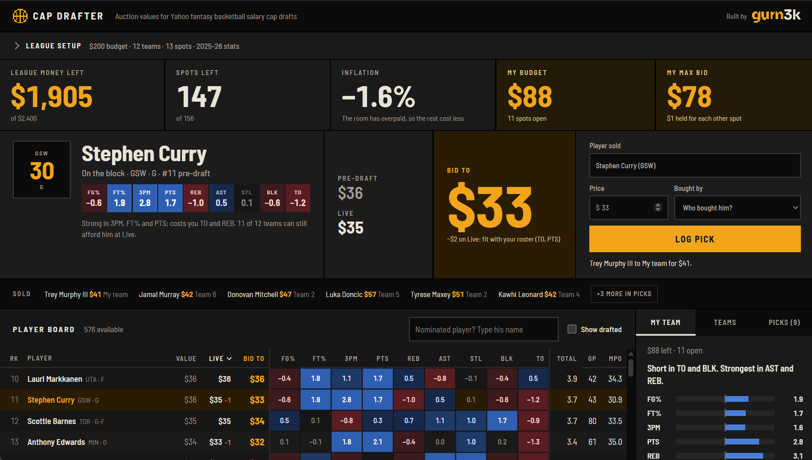

# Cap Drafter

Live auction prices for Yahoo fantasy basketball salary cap drafts.

**Try it:** https://fan-basketball-drafter.vercel.app. It needs no sign-up, and your draft stays in your browser. The site counts page views with Vercel Web Analytics, which sets no cookies and doesn't see your draft.

Found a bug or have an idea? [Send feedback](https://github.com/gurn3k/auction-draft-tool-kit/issues/new?template=feedback.yml).

Not affiliated with Yahoo.



## The problem

In a salary cap draft, every manager gets a budget (Yahoo's default is $200) and bids on players one at a time. Yahoo's draft room shows a fixed "projected salary" next to each player. That number ignores your league's budget, roster size and categories. It also ignores the room: once a few stars sell for more or less than expected, every remaining price should move. Nobody can redo that maths by hand under a 30-second bid clock.

Cap Drafter prices every player for your league and re-prices the board after every sale. It sits in a second window beside the draft room.

## What it does

- **Prices for your league.** Set the budget, teams, roster spots and categories. Each player gets a dollar value, and together the values spend exactly the league's money.
- **Live re-pricing.** Log a sale (player, price, team) and the money and spots left are shared out again over the players still available. The board shows the room's inflation as it happens.
- **Bid to.** The most I should pay: the live price, adjusted toward the categories my roster is short in, and capped at what I can actually bid.
- **Room awareness.** Every team's money left, open spots and max bid, so you can see who can still afford a player.
- **Your own projections.** Upload a CSV to replace the bundled 2025-26 stats.

## How I approached it

I recorded each decision as an ADR while I built, including the ones that reversed earlier calls.

| Decision | Why it's interesting |
|---|---|
| [0001 Web app first](docs/adr/0001-web-app-first.md) | The ideal home is a browser extension inside Yahoo's draft room. I shipped the smallest thing that could be used in a real draft, and kept the engine free of DOM code so an extension can reuse it unchanged. |
| [0002 Valuation method](docs/adr/0002-valuation-method.md) | z-scores against the players who actually get drafted, not the whole league. Shooting percentages are scored by volume-weighted impact, and money is split by value over replacement. The known simplifications are listed rather than hidden. |
| [0006 Worth to you](docs/adr/0006-worth-to-you.md) | League prices ignore your roster. This tilts the price by up to ±20% toward the categories you're losing. The tilt builds up as you fill the first half of your roster. |
| [0005 Yahoo sync, parked](docs/adr/0005-yahoo-sign-in.md) | I built sign-in, league import and live draft sync. Then Yahoo started requiring approval for its Fantasy API, so it waits on a private branch until approval comes through, rather than shipping a button that can't work. |
| [0007 Licensed data](docs/adr/0007-licensed-player-data.md) | Before launch I checked the stats source's terms. They ruled out tools built on scraped data, so I compared five alternatives, switched to a licensed API, and checked the new data matched the old exactly. |
| [0010 Notes, not hand-set prices](docs/adr/0010-player-notes.md) | I set one player's price by hand after a season that looked like an anomaly, then reversed it: prices stay computed from data for everyone, and a note on his card flags the anomaly instead. |
| [0011 My values](docs/adr/0011-my-values.md) | Users can type their own price for any player instead of uploading a whole CSV. Everyone else is re-priced around it, so totals still add up to the league's money. |

[PRD.md](PRD.md) has the scope, success criteria and what's deliberately out.

## How I know the numbers are right

- **The maths is tested.** 65 tests run with `npm test`. They check that values add up to exactly teams × budget, that live prices share out exactly the money left, that illegal picks are refused, and that CSV import and name matching work.
- **The data is cross-checked.** Moving to licensed data changed no one's value. With Yahoo defaults: Nikola Jokić $71, Victor Wembanyama $66, Shai Gilgeous-Alexander $61, and 156 players priced at exactly $2,400.
- **It has been used in a live draft run.** I ran it beside a Yahoo draft room on 2026-10-18.

## What's next

- Yahoo sync, once the Fantasy API access request is approved.
- Positional scarcity, once real Yahoo position eligibility is available.
- Punt builds. The engine already takes any category list.

## Run it locally

```sh
npm run serve     # http://localhost:8080
npm test
npm run fetch     # rebuild player data (needs a balldontlie key; see ADR 0007)
```

Requires Node 22.9+. The app is static, with no build step and no dependencies.

## Layout

```
site/            static app (deploys as-is)
  lib/           pure engine, no DOM: valuation, draft, fit, csv, match, names
  app.js         UI
  data/          players.json (bundled data), projections-template.csv
scripts/         fetch-stats.js + bdl.js (data build), serve.js (local preview)
test/            node --test
data/            display-names.json (hand-kept)
docs/adr/        decision records
```

Player data: [balldontlie](https://www.balldontlie.io/), 2025-26 regular season and 2026-27 rosters, as of 2026-10-19.

© 2026 Gurnek Khaira. Built by [gurn3k](https://www.gurn3k.com).
